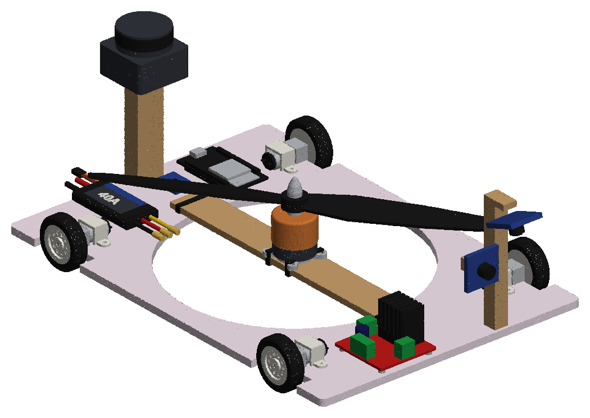

# WCR prototype digital twin

This is the digital twin of the **physical** wall-climbing prototype. It is a foam board held on the wall by propeller thrust, driven by 4 N20 motors with skid steering. It runs in Webots and ROS 2 (Nav2, Foxglove) on three dam faces taken from `wcr_dam_sim`:

- `winter_dam`: face at 53.5°
- `goldeneye_dam`: upstream face, 72°
- `goldeneye_gorge`: downstream face, 89°

It reuses these parts of `wcr_dam_sim`, through its installed `wcr_webots` package:

- the worlds and their assets
- the inspection layouts and wall maps
- `inspection_detector` and `wall_frames`
- the coverage mission (subclassed here)
- the EKF, Nav2 and Foxglove setups (adapted copies)



## Run (WSL)

```
bash tools/wsl_build.sh                                     # once: links ros/wcr_proto into ~/wcr_ws and builds it
bash run_proto.sh winter_dam                                # Webots + Foxglove bridge; drive with teleop_twist_keyboard
bash run_proto.sh goldeneye_gorge mission:=true             # autonomous coverage of the demo area, report in results/
bash run_proto.sh goldeneye_gorge throttle:=7               # the measured 400 g: watch it slide off the vertical face
```

To view it in Foxglove, connect to `ws://localhost:8765` and import `ros/wcr_proto/resource/wcr_proto_foxglove.json`. The layout shows the robot from the URDF on the wall grid, lidar, plan, coverage lanes and coverage map, both camera images, coverage %, thrust and detections.

Only one simulation runs at a time. The launch file refuses to start if Webots is already open, and it closes the Webots window when it stops.

| Argument | Meaning |
|---|---|
| `throttle:=full` | Default. About 850 g, the typical full-throttle thrust of an A2212 1000 KV with a 1045 prop on 3S. |
| `throttle:=2` … `7` | Servo-tester settings, using your scale readings: 100, 200, 250, 300, 350, 400 g. |
| `throttle:=auto` | Planned: the ESP32 drives the ESC with just enough thrust for the tilt (IMU) × 1.3. |
| `throttle:=<grams>` | Any thrust, for "what if" runs. |
| `speed:=0.11` | Speed in m/s. 0.11 is the N20s at 60 rpm; more is a faster-than-real demo. |
| `nav:=true` | Nav2 only, with goals sent from Foxglove. |
| `mission:=true area:=demo` | Autonomous coverage. `area:=s0,s1,t0,t1` gives any rectangle in metres on the face. |
| `fast:=true` | Webots as fast as possible. |
| `tyre_mu:="0.35 0.45" tyre_fds:="0.02 0"` | Tyre model; see the calibration notes below. |

Checks, all run in Webots fast mode without a viewer:

```
bash tools/wsl_mission_test.sh goldeneye_dam               # one mission, prints the report
bash tools/wsl_all_missions.sh                             # all three faces
bash tools/wsl_hold_test.sh goldeneye_gorge 7              # drive off the ledge, park, does it hold?
```

## Files

| Path | What |
|---|---|
| `tools/build_proto_cad.py` | CAD (CadQuery). Writes `cad/wcr_proto.step`, the previews, `cad/parts.json` (every part's mass and position, the centre of mass) and coloured meshes. |
| `tools/build_proto_webots.py` | Writes `webots/protos/WcrProto.proto` (physics, devices) and `ros/wcr_proto/resource/wcr_proto.urdf` from the CAD. |
| `tools/render_urdf.py` | Assembles the URDF the way RViz and Foxglove do, into `cad/urdf_check.png`. |
| `ros/wcr_proto/launch/proto.launch.py` | Writes `webots/worlds/_proto_<world>.wbt` (the dam world with this robot, the asset paths pointed at `wcr_dam_sim`, the tyre contact, and a box face on the gorge), then starts everything. |
| `ros/wcr_proto/wcr_proto/proto_driver.py` | Webots plugin. Applies thrust at the prop hub and drives the skid steer. Odometry comes from the encoders plus gyro. Publishes `/thrust` [g] and `/adhesion` [N]. |
| `ros/wcr_proto/wcr_proto/proto_model.py` | Thrust table and lag, required thrust, skid-steer kinematics. |
| `ros/wcr_proto/wcr_proto/coverage_mission.py` | The dam sim's mission, changed for skid steering: see below. |
| `ros/wcr_proto/config/` | Nav2 (MPPI DiffDrive) and EKF (gyro yaw). |
| `results/` | Mission reports, coverage maps and inspection logs. |

## The model

- **Mass: 439 g.** The hardware is 369 g (you measured 370 g; the battery stays off the robot, on the XT60 lead). The sensor kit adds 70 g. Centre of mass is 29 mm off the wall.
- **Thrust** acts at the prop hub, 53.5 mm off the wall, pushing into the wall. The 1045 prop blows air away from the wall. Spin-up lag is 0.15 s.
- **Drive:** 4 N20 at 60 rpm and 0.2 N·m each, with 35 mm tyres, so 0.11 m/s. Wheelbase 200 mm, track 190 mm.
- **Odometry:** wheel encoders give forward speed, the gyro gives yaw. This assumes the encoder version of the N20.
- **Sensor kit (not on the hardware yet).** Same topics and frames as the dam sim:

  | Sensor | Mounting |
  |---|---|
  | 2D lidar, LD06 class | rear mast, scan plane 110 mm off the wall, above the prop |
  | Wall camera | front mast, tilted 70° toward the wall |
  | Front camera | front mast |
  | IMU, MPU6050 | on the board |

### Tyre calibration (Webots friction)

Webots (ODE) uses a friction **pyramid**, which caused two problems:

1. **With equal grip in all directions (μ 0.7), a skid steer whose wheelbase is at least its track cannot yaw at all.**
   - The sideways scrub at ±wheelbase/2 always beats the wheel pull at ±track/2.
   - The fix is asymmetric tyre friction `coulombFriction [side roll]`. Its first direction (fdir1) is the wheel's **sideways** direction, as the tests showed.
   - Sideways creep under load (`forceDependentSlip [0.02 0]`) lets it turn slowly instead of locking, like rubber does.
2. **The asymmetric pyramid grips about 1.6× its coefficients.**
   - Values of 0.35 / 0.45 hold and slide where rubber on concrete (μ about 0.7) should.
   - Check with `tools/wsl_hold_test.sh`. On the vertical gorge: 300 and 400 g slide off, 850 g holds. The hand calculation says it needs 627 g.
   - Asymmetric friction only works against primitive shapes. The gorge face's collision is a mesh, which is exactly planar over the drive area, so the launch adds a box face 1 mm proud of it.

## What the twin shows

**Thrust to hold on, with μ 0.7 and 439 g:**

| Face | Needed | Measured max (setting 7, 400 g) | Full-throttle estimate (850 g) |
|---|---|---|---|
| Winter dam, 53.5° | 244 g | holds | holds |
| GoldenEye upstream, 72° | ~460 g | borderline (held in the twin) | holds |
| GoldenEye gorge, 89° | 627 g | **slides off** | holds |

**Steering on a wall.** This is the biggest lesson for the hardware.

- With wheelbase (200 mm) ≥ track (190 mm), the robot **cannot turn on the spot on a steep face**. The tyres scrub sideways, and most of their grip is already holding the robot up, so it slides down instead of turning. On the winter dam it would not turn back up from about −45° at all.
- Gentle arcs while driving work. On the vertical gorge it manages about 5°/s at full thrust.
- **What would help:** a wider track or shorter wheelbase (track ≥ 1.2 × wheelbase), more thrust, or 2WD plus castor wheels.

**Coverage path for a skid steer.** The design robot crabs sideways between lanes; this robot can't. So in the mission:

- the robot always faces up the face: up-lanes forwards, down-lanes in reverse;
- lane changes are S-curves (≤ 20–30° of heading) driven 0.3 m past the area edge;
- the goal tolerance is looser, because a skid steer can't correct a small sideways error at the goal.

**Autonomous coverage of the demo area (2.2 m × 2 m), full throttle, speed 0.11 m/s:**

| Face | Coverage | Defects found | Sim time | Path | Report |
|---|---|---|---|---|---|
| Winter dam, 53.5° | 67.9 % | 2 (crack_0, wet_patch_0) | 532 s | 39.2 m | `results/mission_report_winter_dam.txt` |
| GoldenEye upstream, 72° (live run with Foxglove) | 72.6 % | 2 (crack_0, wet_patch_0) | 405 s | 38.5 m | `results/mission_report_goldeneye_dam.txt` |
| GoldenEye gorge, 89° | 73.4 % | 2 (crack_0, wet_patch_0) | 525 s | 40.6 m | `results/mission_report_goldeneye_gorge.txt` |

Coverage maps are in `results/coverage_<world>.png` (green = seen by the wall camera, grey = obstacle).

The bush on each face was in the costmap and was avoided. The winter dam run ended back at the start. On the steeper faces the last diagonal leg home stopped short.

The design robot reached about 85 % on the same areas, because it can crab. "Lane not completed" in the reports means the lane ended just short of its end pose. Coverage counts what the wall camera actually saw.
