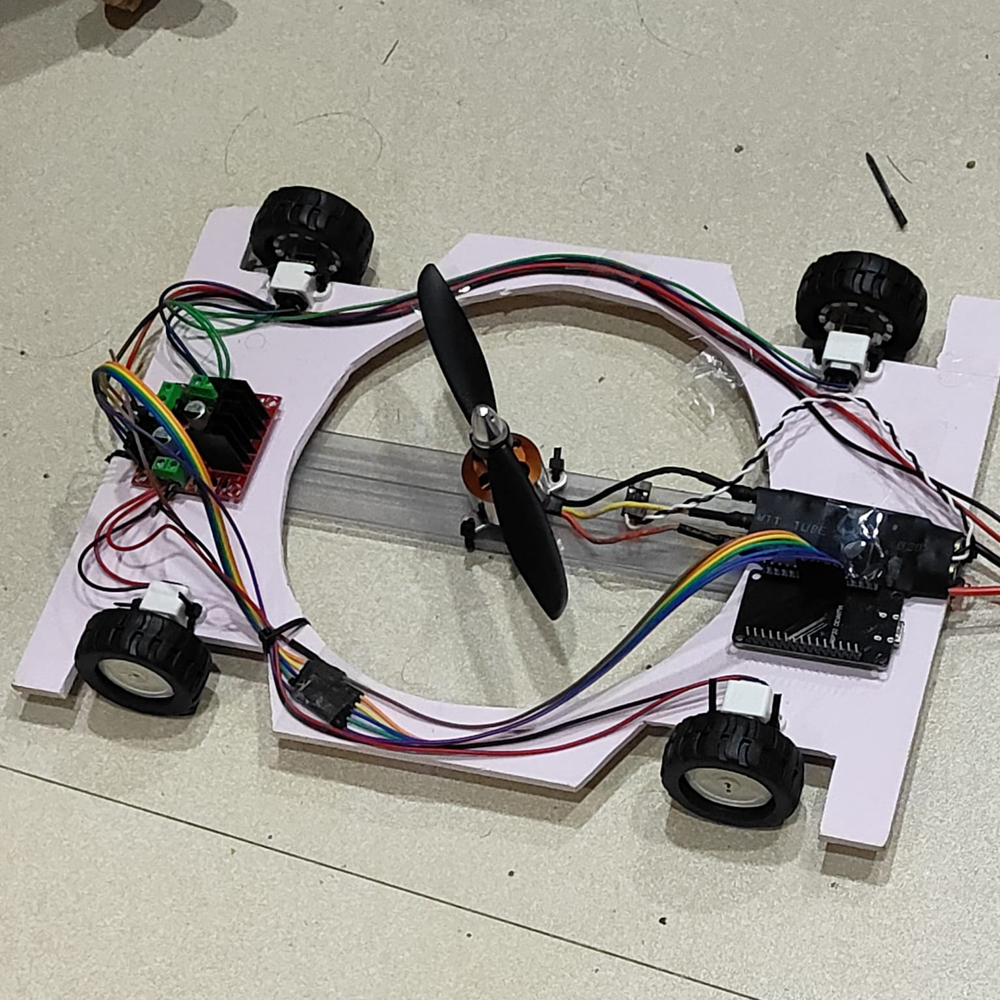
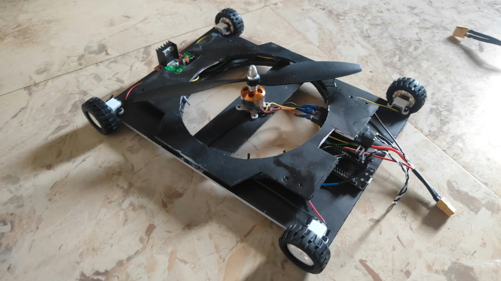
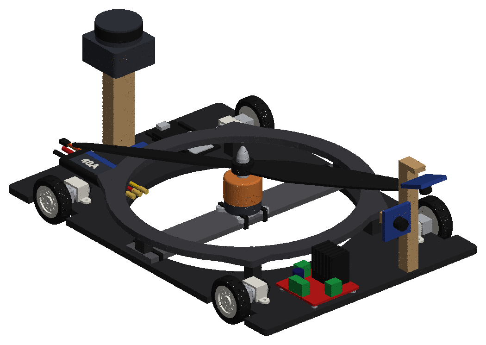

# WCR prototype digital twin: version 2 (rebuilt black robot)

This is the digital twin of the **rebuilt** physical wall-climbing prototype: a foam board held on the wall by propeller thrust, driven by 4 N20 motors with skid steering. It runs in Webots and ROS 2 (Nav2, Foxglove) on three dam faces taken from `wcr_dam_sim`:

- `winter_dam`: 53.5° face
- `goldeneye_dam`: upstream face, 72°
- `goldeneye_gorge`: downstream face, 89°

This is a separate copy of the v1 twin (`Downloads\wcr_proto_twin`, GitHub `Deepak-EL/robro`). The ROS package is renamed `wcr_proto2`, so both versions can be built in `~/wcr_ws` side by side. Only one simulation can run at a time.

| v1 (pink, first build) | v2 (black, rebuilt) |
|---|---|
|  |  |



## What changed in v2

| | v1 | v2 (from the photo) |
|---|---|---|
| Base | 290 × 200 × 5 mm pink foam board, Ø170 cut-out | same footprint, **black** foam board |
| Top deck | none | **second black foam layer, 15 mm above the base on 6 spacers**: a ring (Ø170 inside, Ø198 outside) around the prop, plus tapered front and rear plates |
| Motor strip | front-back, along the cut-out | **across the cut-out, side to side**, black, 196 × 28 × 4 mm |
| ESP32 / ESC | rear left / rear right on the board | same places, now **partly under the top deck** |
| L298N, N20s, clamps, wheels, motor, prop | | unchanged (L298N front right, on the base) |
| Hardware mass | 369 g (370 g measured) | **415 g, estimated**: the deck plus spacers add about 46 g, worked out by area from the base board |
| With the sensor kit (+70 g) | 439 g | **485 g** |
| Centre of mass | 29 mm off the wall | 29 mm off the wall (the deck is low, at 20–25 mm) |

**Please measure these on the real robot.** The v2 numbers are estimates from one photo:

- the whole-robot weight, which goes in `TOTAL_MEASURED_G` and `MASS` in `tools/build_proto_cad.py`;
- the deck height above the base (`DECK_GAP`, assumed 15 mm);
- the outer size of the deck.

Change those constants, then rerun the two build scripts below.

## Run (WSL)

```
python tools/build_proto_cad.py        # Windows venv: CAD, previews, parts.json, meshes
python tools/build_proto_webots.py     # Webots PROTO + URDF from the CAD
bash tools/wsl_build.sh                                     # once: links ros/wcr_proto2 into ~/wcr_ws and builds it
bash run_proto.sh winter_dam                                # Webots + Foxglove bridge; drive with teleop_twist_keyboard
bash run_proto.sh goldeneye_gorge mission:=true             # autonomous coverage of the demo area, report in results/
bash run_proto.sh goldeneye_dam throttle:=7                 # the measured 400 g: watch v2 fall off the 72° face
bash tools/wsl_full_check.sh                                # all hold tests + all three missions -> results/full_check.log
```

To view it in Foxglove, connect to `ws://localhost:8765` and import `ros/wcr_proto2/resource/wcr_proto2_foxglove.json`.

The launch arguments, tyre calibration, steering findings and mission strategy are the same as in v1. See the v1 README and its `docs/REPORT_DATA.md` and `docs/TEST_LOG.md`. The physics, tyre model ([0.35 0.45] with FDS [0.02 0]), Nav2 and mission code are unchanged. Only the CAD, mass and centre of mass changed.

## Results v2

### Thrust needed to hold

With μ 0.7, the robot holds if T ≥ m g (sin β / μ − cos β).

| Face | v1 needs (439 g) | **v2 needs (485 g)** | v2 at 400 g (setting 7, measured max) | v2 at 850 g (full) |
|---|---|---|---|---|
| Winter dam, 53.5° | 243 g | **269 g** | holds | holds |
| GoldenEye upstream, 72° | 458 g | **509 g** | **falls off** (v1 just held) | holds |
| GoldenEye gorge, 89° | 627 g | **684 g** | **falls off** | holds |

The hold tests are `tools/wsl_hold_test.sh`. Each one drives 0.2 m off the deployment ledge, parks, and measures the slide over 20 s. The raw output is in `results/full_check.log`.

**The main v2 finding:** the extra deck weight turns GoldenEye from "just holds at 400 g" into "falls off". At its measured best of 400 g, the robot can only stay on faces up to about 60°:

- 485 g × (sin β / 0.7 − cos β) = 400 g gives β ≈ 63°;
- with a safety margin, that's about 60°.

Steeper faces need the ESC run closer to full throttle, or a lighter deck.

### Autonomous coverage

Demo area 2.2 m × 2 m, 17 lanes, full throttle, 0.11 m/s.

| Face | v1 coverage | **v2 coverage** | v2 defects found | v2 sim time | v2 path | v2 home reached |
|---|---|---|---|---|---|---|
| Winter dam, 53.5° | 67.9 % | **66.4 %** | 2 (crack_0, wet_patch_0) | 375 s | 34.5 m | no |
| GoldenEye upstream, 72° | 72.6 % | **73.4 %** | 3 (crack_0, wet_patch_0, crack_4) | 533 s | 40.5 m | no |
| GoldenEye gorge, 89° | 73.4 % | **73.2 %** | 2 (crack_0, wet_patch_0) | 523 s | 40.5 m | no |

The bush was in the costmap and avoided on every face. At full throttle (850 g), v2 covers the faces about as well as v1. The heavier robot only matters for whether the thrust you have measured is enough to hold it on the wall.

The reports, coverage maps and inspection logs are in `results/`.
